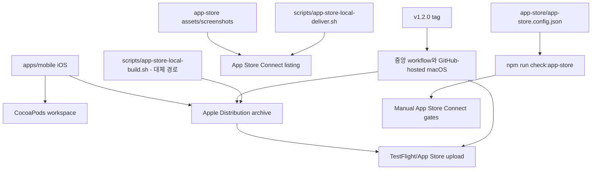

# App Store 등록 정보

## Source Of Truth

- 설정 파일: `app-store/app-store.config.json`
- 이미지 폴더: `app-store/assets`, `app-store/screenshots`
- 검증 명령:

```bash
npm run check:app-store
```

## 현재 판정

v1.2.0 (1002000)은 2026-10-24 09:25 KST에 심사 제출됐고 `WAITING_FOR_REVIEW`다. App Privacy 8개 신고와 문구, 스크린샷 6장 및 실제 빌드 연결을 재조회했다. 승인 후 수동 공개가 남아 있다. 실행별 근거와 남은 단계는 [출시 기록](qa/2026-10-23-single-daily-puzzle/release-status.md)을 따른다. 실제 SDK와 기기 검수는 승인 계획대로 미실행이다.



## 현재 확정값

| 항목                       | 값                                                        |
| -------------------------- | --------------------------------------------------------- |
| 기본 언어                  | `ko-KR`                                                   |
| 앱 유형                    | `game`                                                    |
| 가격                       | `free`                                                    |
| 고객 문의 이메일           | `cs@seorilabs.com`                                        |
| Bundle ID                  | `com.seorilabs.crosswordpuzzle`                           |
| SKU                        | `crossword-puzzle-app`                                    |
| 광고                       | `yes`. `apps/mobile`에 AdMob native adapter 연결          |
| 추적/ATT                   | v1.2.0 실제 신고 `no`, 기기와 SDK 실행은 미실행           |
| Game Center                | iOS adapter·entitlement·콘솔 리더보드 설정 완료           |
| CocoaPods                  | `bundle exec pod install` 완료                            |
| unsigned iOS Release build | `CODE_SIGNING_ALLOWED=NO build` 통과                      |
| App Store CI               | 중앙 GitHub Actions와 public 저장소의 GitHub-hosted macOS |
| 로컬 iOS build             | `npm run app-store:build:local` 준비                      |
| 로컬 metadata 등록         | `npm run app-store:deliver:upload` 준비                   |
| App Store profile          | `AppStore Crossword Puzzle Profile` secret 등록           |
| 최신 업로드 빌드           | `v1.2.0` / build `1002000` / run `39979354182`            |

## 남은 출시 단계

- 접수 `88d496c9-998a-49f8-80b0-93a038f396de`의 Apple 심사 승인
- 기존 수동 공개 방식으로 한국에 공개하고 실제 스토어 버전 확인
- 새 국가와 언어는 추가하지 않는다.

## 로컬 등록/빌드 명령

GitHub Actions minutes가 소진되어도 로컬에서 같은 흐름을 실행할 수 있다.

```bash
npm run app-store:build:local
npm run app-store:deliver:prepare
```

signed archive:

```bash
APPLE_TEAM_ID="HCDUXX4Z3X" \
IOS_PROVISIONING_PROFILE_NAME="AppStore Crossword Puzzle Profile" \
npm run app-store:build:local -- --archive --tag v1.0.0
```

metadata/screenshot upload:

```bash
source "$HOME/.config/seorilabs/app-store-connect.env"
npm run app-store:deliver:upload -- --metadata-only --tag v1.0.0
```

App Store 앱 이름은 iOS용으로 `가로세로 퍼즐`을 사용한다. `--use-suggested-urls`는 `supportUrl`, `privacyPolicyUrl`, `marketingUrl` 후보를 실제 등록값으로 쓰기로 확정한 경우에만 사용한다.

## 2026-06-09 AdMob 콘솔 ID

현재 `react-native-google-mobile-ads` adapter에 연결되어 있다. 개발/QA 빌드는 Google test ad unit을 사용하고, release 빌드는 adapter QA 후 아래 운영 ID를 사용한다. 1차 출시는 개인화 광고를 끄고 비개인화 광고 요청으로 운영하며, global request configuration은 아동 대상/동의연령 미만 대상 플래그를 false로 명시하고 simulator/emulator를 test device로 allowlist한다.

| 항목                | 값                                       |
| ------------------- | ---------------------------------------- |
| AdMob publisher ID  | `pub-9932778305312246`                   |
| iOS AdMob app ID    | `ca-app-pub-9932778305312246~5361317430` |
| `ios_rewarded_hint` | `ca-app-pub-9932778305312246/5603016700` |

`GADApplicationIdentifier`와 `SKAdNetworkItems`는 `app.json`의 `react-native-google-mobile-ads` 설정을 CocoaPods build phase가 빌드 산출물 `Info.plist`에 주입한다. 로컬/App Store archive 경로는 업로드 전에 산출물 `Info.plist`에서 iOS AdMob app ID와 Google SKAdNetwork ID를 다시 검증한다. AdMob 개인화 광고, IDFA, cross-app ad measurement를 켜면 App Store Connect Tracking 답변, ATT/UMP 동선, `NSUserTrackingUsageDescription`도 같이 구현한다.

## 게시된 App Privacy 답변

2026-10-24에 8개 유형을 게시한 뒤 각 질문을 다시 열어 저장값을 대조했다. 데이터 수집은 있음, 추적은 없음이다.

| 유형               | 용도                     | 사용자 연결 | 추적   |
| ------------------ | ------------------------ | ----------- | ------ |
| 대략적인 위치      | 타사 광고, 분석          | 예          | 아니요 |
| 게임 플레이 콘텐츠 | 앱 기능, 분석            | 예          | 아니요 |
| 사용자 ID          | 앱 기능, 분석            | 예          | 아니요 |
| 기기 ID            | 앱 기능, 분석, 타사 광고 | 예          | 아니요 |
| 제품 상호 작용     | 분석, 타사 광고          | 예          | 아니요 |
| 광고 데이터        | 분석, 타사 광고          | 예          | 아니요 |
| 충돌 데이터        | 분석, 앱 기능            | 아니요      | 아니요 |
| 실적 데이터        | 분석, 앱 기능, 타사 광고 | 예          | 아니요 |

신고는 iOS 비개인화 광고, ATT 및 UMP 호출 없음과 Firebase 광고 신호 거부 설정에 맞췄다. 실제 SDK 네트워크와 기기 실행의 통과 증거는 아니다. 이전 공개 버전의 설정도 별도로 대조했고 실제 코드 및 공개 개인정보 문서와 정합성을 확인했다. 세부 근거와 미실행 범위는 출시 기록에 남긴다.

[Apple 신고 기준](https://developer.apple.com/app-store/app-privacy-details/)과 [Google Mobile Ads 수집 항목](https://developers.google.com/admob/ios/privacy/data-disclosure)을 확인했다. SDK와 데이터 사용이 바뀌면 다시 검토한다.

## 연령등급 설문 답변 가이드

v1.2.0의 실제 기존 설문은 광고 있음과 지원하지 않는 콘텐츠 없음으로 재조회했다. 아래는 향후 기능을 바꿀 때의 재검토 기준이며 새 계산 등급을 확정한 기록이 아니다.

전제:

- 현재 native mobile 앱에는 제한 없는 웹 브라우징, 사용자 생성 콘텐츠, 앱 내 채팅, 건강/의료 콘텐츠, 폭력, 무기, 도박, 랜덤 박스, 사용자 간 순위/보상 시합이 없다.
- 현재 native mobile 앱에는 AdMob 광고 SDK가 있으므로 광고 항목은 `예` 기준으로 재검토한다. UGC, 웹 접근, 채팅, 리더보드/이벤트 경쟁, 보상 경쟁, 건강 콘텐츠, 무기/폭력, 도박/랜덤 아이템을 추가하면 설문을 다시 답해야 한다.

최종 iOS 앱에 AdMob, 사용자 생성 콘텐츠, 리더보드/경쟁, 서버 저장, 결제, Game Center, 고객지원 폼, 인증을 붙이면 아래 4+ 후보 답변을 그대로 쓰면 안 된다. 최소한 다음 항목은 재답변한다.

| 항목               | 최종 기능 추가 시 답변                                              |
| ------------------ | ------------------------------------------------------------------- |
| 광고               | AdMob 또는 유료 홍보가 있으면 `예`                                  |
| 사용자 생성 콘텐츠 | UGC가 있으면 `예`                                                   |
| 시합               | 리더보드/이벤트가 순위, 보상, 개인 목표 경쟁이면 `드문` 또는 `빈번` |
| 유해 콘텐츠 차단   | UGC moderation/report/block 같은 제어 기능을 제공하면 `예` 권장     |
| 나이 확인          | 별도 연령 제한 콘텐츠/서비스가 없으면 보통 `아니요`                 |
| 계산된 등급        | 기능 추가 후 App Store Connect에서 재계산. `4+` 보장 불가           |

추천 답변:

| 항목                                                     | 답변        |
| -------------------------------------------------------- | ----------- |
| 유해 콘텐츠 차단                                         | `아니요`    |
| 나이 확인                                                | `아니요`    |
| 제한되지 않은 웹 액세스                                  | `아니요`    |
| 사용자 생성 콘텐츠                                       | `아니요`    |
| 메시지 및 채팅                                           | `아니요`    |
| 광고                                                     | `예`        |
| 욕설 또는 노골적인 유머                                  | `없음`      |
| 잔혹/공포 테마                                           | `없음`      |
| 음주, 흡연 또는 약물 사용                                | `없음`      |
| 의료 또는 치료 정보                                      | `없음`      |
| 건강 또는 웰빙 주제                                      | `아니요`    |
| 성적이거나 선정적인 테마                                 | `없음`      |
| 성적인 내용 또는 노출                                    | `없음`      |
| 노골적인 성적 내용 및 노출                               | `없음`      |
| 만화 또는 비현실적인 폭력                                | `없음`      |
| 적나라한 폭력                                            | `없음`      |
| 잇따른 폭력의 생생한 묘사 또는 가학성을 띤 사실적인 폭력 | `없음`      |
| 총 또는 기타 무기                                        | `없음`      |
| 가상 도박                                                | `없음`      |
| 시합                                                     | `없음`      |
| 도박                                                     | `아니요`    |
| 랜덤 박스                                                | `아니요`    |
| 계산된 등급                                              | `4+` 후보   |
| 연령 카테고리 및 재정의                                  | `해당 없음` |
| 연령 적합성 URL                                          | 비워둠      |

## 등록 문구

앱 이름:

```text
가로세로 낱말 퍼즐
```

부제:

```text
매일 한 판 한글 퍼즐
```

프로모션 문구:

```text
오늘의 한글 낱말을 가로세로로 맞히고 기록을 남겨보세요.
```

키워드:

```text
가로세로,낱말,퍼즐,퀴즈,단어,한글,두뇌,매일,crossword,word
```

최초 출시노트:

```text
가로세로 낱말 퍼즐을 처음 출시합니다.

날짜별 한글 낱말 퍼즐, 힌트 기능, 기기 내 기록 저장을 사용할 수 있습니다.
```

상세 설명은 `app-store/app-store.config.json`의 `storeListing.description.ko-KR`를 기준으로 한다.

## 이미지

| 용도               | 파일                                                                       | 상태                             |
| ------------------ | -------------------------------------------------------------------------- | -------------------------------- |
| Store icon         | `app-store/assets/icon-1024.png`                                           | 생성됨, 디자인 QA 필요           |
| Xcode AppIcon      | `apps/mobile/ios/CrosswordPuzzleMobile/Images.xcassets/AppIcon.appiconset` | iPhone/iPad/marketing PNG 생성됨 |
| iPhone screenshots | `app-store/screenshots/iphone/*.png`                                       | 3장 생성됨, 1320 x 2868          |
| iPad screenshots   | `app-store/screenshots/ipad/*.png`                                         | 3장 생성됨, 2064 x 2752          |

## 주의

- App Store Connect upload는 build accepted/processing까지의 의미이며, 버전 빌드 선택과 최종 심사 제출은 별도 gate다.
- iPad를 계속 지원하면 iPad screenshot과 iPad AppIcon slot까지 준비해야 한다. iPad를 출시 대상에서 뺄 경우 Xcode `TARGETED_DEVICE_FAMILY`부터 바꿔야 한다.
- RNFirebase Analytics/Remote Config와 AdMob SDK를 붙였으므로 `PrivacyInfo.xcprivacy`, App Store Connect privacy 답변, ATT/IDFA 정책을 다시 확인해야 한다. 현재 iOS Analytics는 IDFA 없는 variant이며, AdMob은 비개인화 광고 요청으로 호출한다.
- 2026-04-28 이후 App Store Connect 업로드는 Xcode 26/iOS 26 SDK 이상이 필요하므로 workflow는 `macos-26` runner와 SDK major check를 사용한다.
- 2026-06-07 `v0.1.5` / build `1005` 업로드 run `27087313726`, job `79945275484`는 성공했다.

## 2026년 10월 27일 영문 등록정보

다음 업데이트용 영문 문구와 실제 플레이 스크린샷을 준비했다. [원본, 검증과 남은 단계](qa/2026-10-27-english-storefront/README.md)를 따른다. 현재 공개 버전이나 판매 국가의 변경을 뜻하지 않는다.
