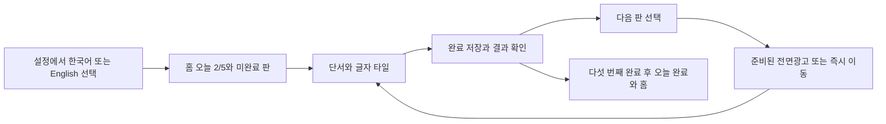

# 한국어와 영어 하루 5판, 전면광고 전환

상태: 구현과 개발 검증은 PR #451로 완료했다. 최초 기준 SHA는 `85a6109873d22d440696d738eef129cab80234a9`다. 이후 사용자가 v1.3.0으로 기존 세 마켓 공개까지 진행하도록 범위를 확장했다. 아래 최초 구현 기록은 당시 범위와 함께 보존하고, 현재 출시 범위는 마지막 절과 test-plan.json을 따른다.

## 화면과 흐름

기존 크림색 바탕, 녹색 보드, 주황색 주 행동과 8×8 타일 UI를 재사용한다.

홈은 오늘 진행과 현재 미완료 판 시작을 우선한다. 결과는 다음 판을 주 행동으로 표시하고 마지막 판은 오늘 완료와 홈 이동을 제공한다. 설정에서 언어를 전환하며 기존 진행은 유지한다. 긴 영어 단서는 줄바꿈하고 320px와 큰 글자에서 입력 및 결과를 확인한다.

## 정책과 경계

- 순수 정책과 이벤트 계약은 `packages/crossword-core`에 둔다. SDK와 저장소는 각 플랫폼 adapter가 맡는다.
- 한국어 날짜는 Asia/Seoul, 영어 날짜는 사용자 현지 달력 날짜다. 영어는 A~Z 대문자로 정규화한다. 반복 글자는 별도 타일이며 한글 음절과 두 글자 조각 제한을 영어에 적용하지 않는다.
- 언어별 하루 5판. 한국어 18~22단어, 영어 12~18단어. 같은 날 5판과 직전 14일의 정답을 재사용하지 않는다. 기존 한국어 주소와 저장 ID는 보존한다.
- 새 manifest는 언어와 일일 순번을 포함한다. 언어 없는 기존 퍼즐은 한국어다. 영어 ID와 저장 키는 `en-`으로 구분한다. 영어는 미래 2일을 준비하되 사용자 날짜보다 미래인 판을 숨긴다. 발행한 슬롯은 재생성으로 교체하지 않는다.
- 영어 후보는 최소 2,500개다. 미국식 일상 어휘를 우선하고 WordNet 활용 항목의 의미 ID와 출처 및 전체 라이선스를 보존한다. 영어 공급 실패를 한국어로 대체하지 않는다.
- 기록과 연속 일수는 언어별로 구분한다. 같은 날짜의 여러 완료는 연속 일수를 한 번만 늘린다. 영어는 한국어 순위에 제출하지 않으며 영어 순위 설정 전 버튼을 숨긴다.
- 무료 힌트, 보상형 힌트 광고, 힌트 지급과 유도 문구, 신규 무힌트 배지를 제거한다. 이전 저장의 힌트 값과 확정 글자만 복원에 필요한 범위에서 유지한다.
- 완료 저장과 결과 확인 후 다음 판 이동 시 전면광고를 판마다 한 번 시도한다. 마지막 판은 결과에서 홈으로 이동할 때 시도한다. 같은 결과 재방문은 중복 노출하지 않는다. 미리 준비된 광고만 표시하고 닫힌 후 이동한다. 미준비, 공급 없음, 오류는 즉시 이동한다. 늦은 로드 콜백은 풀이 위 광고를 띄우지 않는다. 중복 클릭은 한 전환으로 합친다.
- 전면광고는 별도 운영 지면을 사용한다. 미설정이면 건너뛴다. 기존 보상형 지면은 재사용하지 않는다. 실제 제공자 SDK 노출은 이번 개발 대체 실행으로 입증하지 않는다.
- 기존 완료 이벤트에 콘텐츠 언어, UI 언어와 일일 순번을 추가하고 광고 요청, 노출, 닫힘, 실패를 구분한다.

## 인수조건

| ID | 조건 |
| --- | --- |
| AC-1 | 언어별 5판과 날짜, 순서, 미래 숨김, 시간대 변경 시 중복 지급 방지 |
| AC-2 | 2,500개 이상 영어 후보, 의미 및 라이선스, 두 언어 30일 300판의 분량, 연결성, 교차 품질, 단서와 14일 중복 검사 |
| AC-3 | 기존 한국어 저장과 확정 글자, 언어 전환과 재실행 복원, 언어별 기록과 일수 |
| AC-4 | 양 언어 시작, 타일 입력, 오답 복구, 완료, 다음 판과 다섯 판 완료, 오프라인 및 오류 복구 |
| AC-5 | 힌트 제거와 결과 이동 광고의 성공, 닫힘, 미준비, 오류, 늦은 콜백과 연속 클릭 |
| AC-6 | 안내, 설정, 오류, 공유와 접근성 번역, 영어 순위 차단, 언어와 순번 telemetry |
| AC-7 | 320px와 큰 글자, 양 플랫폼 실제 개발 화면, 독립 기능 및 UX 검수 3회와 전체 회귀 |

## 검증과 운영

순수 정책과 adapter의 행동은 실패 테스트를 먼저 확인한다. 어휘 자료와 번역은 정적 검사와 실제 퍼즐 생성 및 화면 실행으로 검증한다. L3 개발 환경 전체 회귀와 작성자 외 독립 화면 검수 3회를 실행한다. 각 회차의 계획을 실행 전에 고정하고 실패 원본을 보존한다. core, adapter, component, operations와 typecheck, lint, release parity, build, mobile 검사를 수행한다. 빌드 전 중앙 검증기를 적용한다. 기기와 운영 배포는 사용하지 않는다.

기존 주소는 구버전 클라이언트용으로 유지하며 새 manifest를 분리한다. 롤백은 이전 클라이언트와 manifest 경로로 되돌릴 수 있다. 기존 발행 원본과 사용자 저장을 삭제하지 않는다. 운영 지면, 국가, Remote Config의 운영 반영과 서버 배포는 이번 범위 밖이다. 증적 원본은 NAS1dual로 이관하고 Git에는 요약과 위치를 남긴다.

참고: [WordNet 이용 조건](https://wordnet.princeton.edu/license-and-commercial-use), [AdMob 전면광고 지침](https://support.google.com/admob/answer/6201362?hl=en). 사용자 제공 계획을 정본으로 재승인 없이 실행한다.

## 구현 결정과 검수 추적

사용자는 공급 탐색 뒤에도 교차 칸 55%를 유지하고 생성기를 보완하도록 선택했다. 기존 탐색기의 품질 기준은 낮추지 않았다. 별도 검증된 8×8 모양 3,102개와 교차 제약을 전파하는 단어 배치를 사용한다. 영어는 3,238개, 한국어는 기존 검수와 별도 승인 단서를 합친 3,088개 후보를 공급한다. 두 언어 30일 300판은 교차 칸, 두 번 이상 교차, 연결성, 단서와 14일 중복을 독립 검사한다. 원래 한국어 사전과 구버전 생성 경로는 유지한다.

콘텐츠 원본과 라이선스는 [PR #450](https://github.com/seorilabs/crossword-puzzle/pull/450)으로 분리해 병합했다. 앱 정책, 저장, 결과 이동과 플랫폼 adapter는 동일 전환을 이루므로 하나의 구현 PR에서 검증한다. 운영 생성과 공개는 분리했으며 이 작업은 파일 생성까지만 실행한다.

새 순수 정책과 광고 전환에는 행동 테스트를 추가했다. 어휘 선별, 번역과 기존 App의 넓은 화면 교체에는 동일한 실패 테스트를 복제하는 대신 전체 회귀와 입력 기반 독립 화면 3회를 사용한다. 이전 힌트 hook과 SDK 보상 호출, 그 기능만 검사하던 테스트는 승인된 기능 제거에 따라 삭제한다. 과거 저장의 힌트 값과 확정 글자는 보존한다.

실행 티켓은 [#449](https://github.com/seorilabs/crossword-puzzle/issues/449)다. 실제 제공자 광고 SDK 노출, 알림 제공자, OS 권한과 마켓은 개발 경계 대체 실행으로 입증하지 않는다. 실행 원본과 실패 이력의 NAS 위치는 검수 요약에 기록한다.

## v1.3.0 공개 범위 확장

사용자는 앞서 제안한 v1.3.0에 대해 “공개출시까지 진행”이라고 지시했다. 이 작업 대화의 지시를 태그 전에 현재 설계와 테스트 계획에 고정한다. Google Play, App Store와 AppsInToss에서 빌드, 내부 테스트 배포, 제출, 승인 뒤 공개 및 실제 공개 상태 확인까지 진행한다. 새 클라이언트에 필요한 언어별 콘텐츠 공급과 Hosting 공개를 service 대상으로 포함한다. 기존 국가, 가격, 계정과 식별자를 유지하며 새 국가를 추가하지 않는다. Play는 기존 전체 배포, App Store는 기존 수동 공개 방식을 유지한다.

기존 결과 원본은 보존한다. 구현 PR #451의 최종 후보 f01a1d6과 main98a7281은 같은 Git tree35972a4f4ac943984857791539293cc0d4fee71f를 가졌다. 원래 화면 검수1·2회 실패와3회 통과, 각각의 SHA와 시각을 바꾸지 않고 후속 해결 근거를 연결한다. 화면을 다시 설계하지 않으므로 네 번째 UI 검수를 임의로 추가하지 않는다. 서버 연결과 출시 설정을 포함한 새 최종 SHA에서는 L3 기능 회귀와 서비스 통합을 독립 실행한다. 실제 SDK와 OS 검수 미실행은 그대로 구분하며 기기 접근을 출시 승인으로 대신하지 않는다.

현재 확인한 사전 조건은 다음과 같다. 새 언어별 manifest는 공개 서버에서 아직404이며, 저장소의 전면광고 지면 기본값은 비어 있다. 운영 Remote Config는 별도로 재조회한다. 기존 정답 이력을 반영한 로컬35판 생성은 통과했지만 공개 게시로 해석하지 않는다. 새 공급은 기존 한국어 발행 원본과 다른 Hosting 파일을 보존하고, 검증 완료 뒤 한 번의 공개 전환으로 반영한다. 발행된 ID와 정답을 재생성으로 바꾸지 않는다. 서버 스케줄과 실제 공개 결과를 readback하며 실패하면 이전 정상 공급으로 복구한다.

운영 지면은 기존 보상형 ID를 재사용하지 않는다. 지면을 새로 만들어야 하면 구체적인 대상과 설정을 확인한 뒤 해당 작업을 별도로 다룬다. 국가, 가격, 정책 답변, 키와 자격증명 변경, 지원팀 연락 및 기기 사용은 이번 공개 지시로 임의 확대하지 않는다.

마켓별 source, artifact, upload, processing, submission, approval, public과 실제 실행을 별도 기록한다. 태그는 중앙 원장으로만 생성하고 각 마켓의 기존 등록과 처리 상태를 먼저 조회한다. 이전 버전 심사가 진행 중이면 그 원본과 제출을 임의 취소하지 않는다. 최신 중앙 검증기를 각 단계와 대상에 실행하고 같은 후보의 실제 근거만 연결한다.
