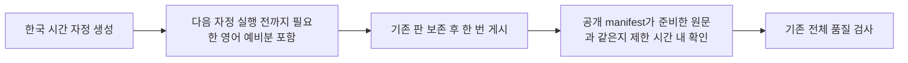

# 게시 직후 확인과 영어 예비 공급 수정

사용자 요청: “실패는 왜 한거야? 예비분 누락은 액션할게 있어? 액션할게 있다면 대응해”. 2026-10-29의 운영 장애 대응 범위로 구현, 검증, PR, 기존 서비스 적용과 부족분 보충을 수행한다. 앱 기능과 마켓 바이너리는 바꾸지 않는다.

## 근거와 범위

10월 29일 00:11:04 KST Hosting release 생성 완료 뒤 00:11:05 검사에서 오늘 easy와 hard 누락을 보고했다. 00:40 재검사는 통과했다. 게시 직후 검사에 준비한 manifest와 공개 응답의 일치 확인이 없었다. 당시 응답 원문은 로그에 없어 CDN 전파 원인은 추정으로 구분한다.

영어 검사는 실행 시점의 UTC 어제부터 5일을 요구한다. 자정 KST 생성 직후에는 10월 31일까지면 통과하지만 오전 9시 이후에는 11월 1일까지 필요하다. 생성 범위를 다음 자정 KST 실행 직전까지의 검사 범위를 포함하도록 넓힌다. 현지 날짜와 하루 5판 정책, 14일 정답 중복 금지, 보드 품질은 유지한다.

## 인수조건과 테스트

- AC-1: 다음 한국 시간 자정 실행 전까지 UTC 날짜가 바뀌어도 영어 예비분이 충분하다. 자정, 오전 9시, 월말, 연말 경계 테스트로 확인한다.
- AC-2: 게시 직후 이전 manifest가 HTTP 200으로 응답해도 준비한 세 manifest 원문이 보일 때까지 한정 재조회한다. 기한이 지나거나 실제 품질이 나쁘면 실패하고 재게시하지 않는다.
- AC-3: 부족한 판만 생성하고 기존 모든 판의 SHA-256을 보존한다. 공개 이후 전체 health를 실행한다.

검수는 L1 서비스 런타임에서 수행한다. 변경 회귀 테스트, 전체 운영 테스트, release parity, 앱 빌드와 mobile 검사를 실행한다. UI와 네이티브 SDK 변경이 없어 기기 검수는 적용하지 않는다.

## 적용과 복구

먼저 기존 Job을 한 번 실행해 빠진 11월 1일 영어 5판을 보충한다. 코드 검증과 PR 병합 뒤 고정 digest를 사용해 generator와 health를 함께 교체한다. 기존 환경 변수와 권한, 스케줄을 보존한다. 실패 시 이전 두 Job 이미지로 복구하며 발행 보드 원문은 되돌리거나 덮어쓰지 않는다. 보존 스크립트와 중앙 배포 검증을 적용한다.
