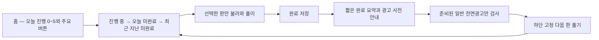

# 퍼즐 연속 플레이와 완료 광고

사용자 승인 근거: 2026-10-31 대화에서 제공한 「퍼즐 연속 플레이 개편과 세 마켓 공개」 계획을 구현하고 검증하라는 지시. 아래 내용은 그 계획의 저장소 기록이다.

## 흐름과 화면

기존 크림색 바탕, 녹색 글자와 주황색 주요 버튼을 유지한다. 홈의 보드 미리보기와 미리 내려받기를 없애고 5칸 진행 표시로 바꾼다. 날짜와 판 선택, 기록은 보조 화면에서 제공한다. 결과는 짧은 요약과 아래 고정된 다음 판 버튼을 제공한다. 모든 판 완료, 저장된 판 없음, 다운로드 실패와 저장 실패를 구별한다. 큰 글자와 작은 화면에서도 고정 버튼이 내용을 가리지 않게 한다.

## 공통 정책과 저장

`packages/crossword-core`가 언어, 날짜, 순번, 진행과 소진 상태를 사용해 선택한다. 진행 중인 판을 먼저 복원하고, 오늘 미완료 판, 날짜 역순의 지난 미완료 판을 고른다. 날짜 안에서는 순번 오름차순이다. 완료, 도전 소진, 미래, 다른 언어는 제외한다. 언어 전환과 재실행에도 저장된 미션과 원래 퍼즐 ID, 날짜를 사용한다. 목록은 재사용하고 저장된 원본을 먼저 읽으며 선택한 한 판만 내려받는다. 전체 지난 판 다운로드를 하지 않는다. 완료 원본 30개 상한과 별개인 미션 상태로 재추천을 막는다. 활동일은 완료 시각의 콘텐츠 날짜이며 지난 판을 오늘 진행이나 일일 순위에 넣지 않는다.

## 광고와 계측

일반 전면광고와 기존 세 마켓 지면, SDK, 권한을 유지한다. 첫 세션부터 실제 전경 풀이 90초 이후 완료 구간에서 검사한다. 이전 광고 닫힘 후 90초, 세션 3회, UTC 하루 10회이며 30분 비활동으로 세션을 나눈다. 활성 여부, 최초 대기, 간격과 상한은 공통 원격 설정이다. 활동 시간과 실제 노출, 닫힘 이력은 로컬 저장한다. 완료 저장 후 결과 요약과 사전 안내를 먼저 그린 뒤 이미 준비된 광고만 표시한다. 버튼 활성화 후 늦은 로드로 표시하지 않는다. 결과 재방문, 완료판 열람, 홈과 뒤로 이동은 광고 기회가 아니다. 중복 클릭과 콜백은 무시한다. 미준비, 간격과 상한은 실패와 별도 이벤트다. SDK 화면 표시와 impression 이벤트를 구별한다.

## 비용, 적용과 복구

한국어와 영어 하루 각각 5판, 생성기, Cloud Run, 예약 작업과 DB 사용 계약은 변경하지 않는다. 기존 게시본을 사용한다. 동일 판 수의 요청 수와 전송 바이트를 실행 전후 비교한다. 전송비 절대 불변은 보장하지 않는다. 문제 시 기존 릴리스로 복구하고 광고 활성 설정으로 중단할 수 있다. 국가와 가격은 기존 값 유지다.

## 검수와 출시

L3 개발 환경 전체 회귀, 독립 기능/UX 3회. 실제 AIT App과 RN Android/iOS 분기를 실행하고 SDK 경계는 대체 입력으로 구별한다. 5번째→지난 판, 중단/복원, 30개 초과 완료, 언어, 자정, 오프라인, 다운로드/저장 실패, 90초 경계, 간격/상한/재실행, 중복/늦은 콜백/재방문, 작은 화면/큰 글자/접근성을 확인한다. core, adapter, component, operations, typecheck, lint, release-parity, build, mobile 검사를 실행한다. 실제 SDK 노출이나 실기기 통과로 표시하지 않는다.

한국어 Ready PR과 필수 검사, 로컬 코드 리뷰 후 병합한다. 같은 후보로 AIT, Google Play, App Store를 빌드하고 테스트 배포, 중앙 검증, 심사, 승인과 공개까지 진행한다. Play 전체 출시 비율은 1이다. 빌드, 업로드, 심사, 승인, 공개와 공개 버전 확인을 각각 기록한다. 기기 접근은 승인되지 않았다. 변경 없는 SDK와 권한을 이유로 기기 실행을 요구하지 않는다. 마켓 대기와 외부 차단은 실제 상태 그대로 남긴다.
