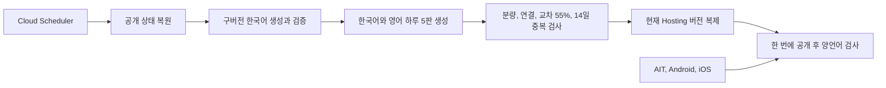

# Puzzle Pack Cloud Run Job

퍼즐 JSON pack을 로컬과 Cloud Run Job에서 같은 entrypoint로 생성한다.



## 언어별 하루 5판 운영

`npm run job:puzzle-pack`은 기존 `/puzzles/manifest.json` 공급을 유지하며 `/puzzles/ko/manifest.json`과 `/puzzles/en/manifest.json`을 함께 준비한다. 운영 실행에는 `PUZZLE_HOSTING_BASE_URL`, `FIREBASE_PROJECT_ID`와 `FIREBASE_HOSTING_SITE`가 필요하다. 출력 폴더를 지정하지 않으면 실행마다 임시 public 폴더를 만들고 종료 시 지운다. 이미지에 포함된 예전 manifest와 웹 자산을 게시 입력으로 사용하지 않는다.

기존 한국어 manifest와 정답 이력, 참조하는 모든 퍼즐의 원문을 먼저 복원한다. 이미 공개된 슬롯은 생성기를 호출하지 않고 원래 JSON 바이트를 유지하며, 새 날짜나 빠진 슬롯만 하나씩 생성한다. 오늘의 쉬운 판만 있으면 어려운 판만 만든다. 새 한국어 판을 준비한 뒤 같은 날 재실행해도 구버전 판은 재생성하지 않는다. 복원 오류는 빈 상태로 대체하지 않고 중단한다.

생성 뒤와 게시 직전에는 기존 공개 판의 바이트, 기존 manifest가 참조한 이력과 90일 보존 창 안의 이력 레코드를 대조한다. 날짜가 지난 레코드의 정상 만료 정리는 기존 `retentionDays` 기준으로 허용한다. 판 식별자는 숫자 길이나 현재 ID 모양으로 제한하지 않는다.

한국어는 KST 오늘과 내일 10판, 영어는 UTC 어제부터 3일 뒤까지 25판을 준비한다. 영어의 현지 날짜 양끝과 미래 2일을 포함하는 범위이며 클라이언트가 미래 판을 숨긴다. 두 언어의 하루 5판, 단어 수, 단서, 연결성, 교차 칸 55%와 14일 정답 중복 조건을 낮추지 않는다. 복원한 모든 발행 판을 다시 검사하고 같은 슬롯의 퍼즐 원문은 보존한다.

구버전 한국어 생성 전에 새 한국어의 발행 정답을 14일 범위에서 제외한 임시 단어 목록을 만든다. 구버전 생성 뒤에는 그 실행의 정답 이력을 새 한국어의 제외 이력에 합친다. 새 5판을 구버전의 90일 이력에 넣어 기존 검사 규칙을 바꾸지는 않는다.

처음 언어별 manifest가 없는 경우에만 **해당 1회 실행의 환경 변수 override**로 `PUZZLE_LANGUAGE_BOOTSTRAP=true`를 전달한다. 이때도 404만 초기 공급으로 해석하며 네트워크 오류, 잘못된 원문과 정답 이력 누락은 실패한다. 한국어 초기 공급은 공개된 기존 정답 이력을 읽어야 한다. 이 변수를 Job의 지속 설정이나 Scheduler에 저장하지 않는다. 이후 실행은 두 언어의 공개 원문 복원이 필수다.

게시기는 현재 live release와 config를 읽고 [`versions.clone(finalize:false)`](https://firebase.google.com/docs/reference/hosting/rest/v1beta1/sites.versions/clone)으로 전체 파일을 보존한다. 기존 리다이렉트, rewrite와 다른 경로의 헤더는 유지하고 퍼즐 경로의 CORS와 캐시 헤더만 설정한다. 생성한 `/puzzles/` 파일을 덮은 뒤 `FINALIZED`와 `releases.create`를 한 번씩 호출한다. 그 외 웹 파일을 로컬 원본으로 덮지 않으며, 이미 발행한 퍼즐 JSON의 해시가 다르면 언어나 ID 모양과 관계없이 중단한다. 생성 시작부터 공개 직전 사이 live release가 바뀌어도 공개를 중단한다. API가 비교 후 쓰기의 원자적 조건을 제공하지 않으므로 생성 및 Hosting 배포를 동시에 실행하지 않는다.

갱신을 허용하는 JSON은 아래 7개 경로뿐이다. 루트의 세 파일은 기존 생성기가 쓰며, 언어별 네 파일은 언어 생성과 상태 복원이 쓴다. 그 밖의 기존 `/puzzles/` JSON은 임의 ID의 과거 판과 하위 폴더의 판까지 불변으로 취급한다. 로컬에서 파일이 빠져도 Hosting clone에 남아 있는 기존 주소를 삭제하지 않는다.

- `/puzzles/manifest.json`
- `/puzzles/answer-history.json`
- `/puzzles/generation-report.json`
- `/puzzles/ko/manifest.json`
- `/puzzles/ko/prior-answer-history.json`
- `/puzzles/en/manifest.json`
- `/puzzles/en/prior-answer-history.json`

기존 보호 이미지 교체 절차에서 generator와 health는 같은 digest를 유지한다. 최초 언어 전환에서는 새 generator를 위의 실행 한정 bootstrap override로 한 번 실행한 뒤 새 health를 실행해야 한다. health만 먼저 실행하면 아직 없는 manifest를 실패로 보고 이전 이미지로 돌아간다. 기존 보호 태그와 이전 digest, live Hosting version을 기록한 뒤 전환하고, 실패하면 두 Job을 함께 이전 digest로 복원한다. IAM, 리소스 생성과 스케줄 변경을 포함하는 초기 설치 스크립트를 기존 이미지 교체에 무심코 재실행하지 않는다.

`health:puzzles`는 기존 한국어 검사에 더해 두 언어의 오늘과 준비 범위, 모든 날짜의 5판 구성, 보드 품질과 14일 중복을 공개 원문으로 검사한다. 생성과 복제, 업로드가 실패하면 `releases.create`를 실행하지 않는다. 공개 뒤 검사가 실패하면 명령도 실패하며 운영 기록에 실패 상태를 남긴다.

## 로컬 검증

추적 중인 `public/puzzles`를 건드리지 않으려면 임시 public root 아래에 생성한다.

```bash
rm -rf /tmp/crossword-puzzle-public
npm run batch:puzzles -- \
  --days=1 \
  --start=2026-05-30 \
  --seed=20260530 \
  --outDir=/tmp/crossword-puzzle-public/puzzles

npm run validate:puzzles -- \
  --manifest=/tmp/crossword-puzzle-public/puzzles/manifest.json \
  --assetRoot=/tmp/crossword-puzzle-public
```

Cloud publish 계획만 확인하려면 dry run을 사용한다.

```bash
npm run publish:puzzles -- \
  --dryRun \
  --project=<firebase-project-id> \
  --site=<firebase-hosting-site-id> \
  --publicDir=/tmp/crossword-puzzle-public \
  --manifest=/tmp/crossword-puzzle-public/puzzles/manifest.json
```

Cloud Run Job과 같은 wrapper를 로컬에서 검증하려면 publish만 끈다.

```bash
npm run job:puzzle-pack -- \
  --days=1 \
  --start=2026-05-30 \
  --seed=20260530 \
  --outDir=/tmp/crossword-puzzle-job-public/puzzles \
  --skipPublish
```

## Cloud 구성

사전 조건:

- Google Cloud / Firebase project가 존재해야 한다.
- Firebase Hosting site가 존재해야 한다.
- 로컬에서 `gcloud` 인증과 project 접근 권한이 있어야 한다.

현재 dev 환경:

| 환경 | Firebase project ID      | Hosting site ID          | Hosting URL                              |
| ---- | ------------------------ | ------------------------ | ---------------------------------------- |
| dev  | `crossword-puzzle-79ae0` | `crossword-puzzle-79ae0` | `https://crossword-puzzle-79ae0.web.app` |

설정:

```bash
scripts/setup-puzzle-pack-cloud-run-job.sh \
  --project-id <firebase-project-id> \
  --firebase-hosting-site <firebase-hosting-site-id> \
  --region asia-northeast3 \
  --scheduler-location asia-northeast3 \
  --schedule "5 0 * * *" \
  --time-zone Asia/Seoul \
  --puzzle-days 1 \
  --puzzle-keep 14 \
  --puzzle-interval-hours 1
```

스크립트가 수행하는 일:

- 필요한 API 활성화
- Artifact Registry Docker repository 생성
- Cloud Run Job runtime service account 생성
- runtime service account에 `roles/firebasehosting.admin` 부여
- `Dockerfile.puzzle-pack-job` 이미지 build/push
- Cloud Run Job 생성 또는 업데이트
- Scheduler service account 생성
- Scheduler service account에 Cloud Run Job `roles/run.invoker` 부여
- Cloud Scheduler HTTP job 생성 또는 업데이트

즉시 1회 실행:

```bash
gcloud run jobs execute crossword-puzzle-pack-generator \
  --project <firebase-project-id> \
  --region asia-northeast3 \
  --wait
```

## 하루 큰 판 전환

기존 배포는 전환 날짜를 지정하기 전까지 Easy와 Hard 두 판을 유지한다. 새 클라이언트를 세 마켓에 공개한 뒤 다음 공개 날짜를 `--single-daily-from YYYY-MM-DD`로 지정한다. 이 옵션은 `PUZZLE_SINGLE_DAILY_FROM_DATE`를 Job에 전달하고 기본 스케줄을 전날 23:00으로 바꾼다. `--schedule`을 함께 주면 그 시간을 사용한다. 전환 전 날짜를 앞당기거나 이미 발행한 판을 다시 만들지 않는다.

전환일부터 다음 날짜 8×8 Hard 한 판을 준비하며 공개 시각은 그 날짜의 현지 자정이다. 기존 식별자 규칙인 `YYMMDD01`, `YYYY-MM-DD-h01`을 유지한다. manifest의 `dailyPolicy.singleFromDate`는 첫 전환 날짜로 고정된다. 원격 manifest와 정답 이력을 읽는 append 실행에서 이미 발행한 ID는 보존하고, 기존 두 판을 새 정책으로 재분류하려 하면 실패한다.

생성은 전체 24,963단어에서 양의 가중치로 추첨하며 정답 90일, 어근 14일 제한을 유지한다. 단일 판은 최소 20단어를 요구하고 기존 품질 조건을 그대로 적용한다. 기준을 통과하지 못하면 발행을 중단한다. 지정한 주제로 어휘 풀을 줄이는 운영 모드는 단일 판에서 사용하지 않는다.

생성 Job은 Hosting 공개 뒤 생성 대상 날짜로 즉시 health를 실행한다. `00:40` health는 당일을 다시 검사한다. health는 manifest의 전환일 전에는 기존 두 판, 전환일부터는 Hard 한 판을 요구한다. 아직 공개 시각 전인 미래 판은 클라이언트가 노출하지 않는다.

현재 이 옵션은 코드에 준비된 상태다. 실제 Job, Scheduler와 공개 manifest의 전환 여부는 출시 실행 기록의 live 확인으로 판정한다.

## Runtime env

Cloud Run Job은 다음 환경 변수를 사용한다.

| 변수                                 |                               기본값 | 설명                                                                                                                      |
| ------------------------------------ | -----------------------------------: | ------------------------------------------------------------------------------------------------------------------------- |
| `FIREBASE_PROJECT_ID`                |                                 필수 | Firebase Hosting project                                                                                                  |
| `FIREBASE_HOSTING_SITE`              |                                 필수 | Firebase Hosting site ID                                                                                                  |
| `PUZZLE_DAYS`                        |                                  `1` | 한 번에 생성할 퍼즐 슬롯 수                                                                                               |
| `PUZZLE_TIME_ZONE`                   |                         `Asia/Seoul` | 동적 시작 날짜 계산 timezone                                                                                              |
| `PUZZLE_SINGLE_DAILY_FROM_DATE`      |                                 비움 | 단일 큰 판 전환 날짜. 지정하면 다음 날짜 자정 공개를 준비하며 manifest에 최초 전환일을 보존                               |
| `PUZZLE_SEED`                        |                                 자동 | 재현용 고정 seed. 지정하지 않으면 `PUZZLE_TIME_ZONE`, 시작 날짜, `PUZZLE_PUBLISHED_AT`을 섞어 실행마다 다른 seed를 만든다 |
| `PUZZLE_OUT_DIR`                     |                     실행별 임시 폴더 | 명시하면 생성 결과를 해당 폴더에 보존                                                                                     |
| `PUZZLE_HOSTING_BASE_URL`            |             `https://<site>.web.app` | 앱/운영자가 참조할 base URL                                                                                               |
| `PUZZLE_APPEND`                      |                               `true` | 기존 manifest를 불러와 새 퍼즐을 append할지 여부                                                                          |
| `PUZZLE_KEEP`                        |                                 `14` | manifest에 유지할 최근 퍼즐 수. 일간 2판 기준 7일치                                                                       |
| `PUZZLE_INTERVAL_HOURS`              |                                  `1` | Easy/Hard의 내부 `slotId`를 h00/h01로 분리하는 간격                                                                       |
| `PUZZLE_DIFFICULTY`                  |                                 비움 | 지정하면 모든 슬롯을 해당 난이도(`easy`/`hard`)로 고정                                                                    |
| `PUZZLE_DAILY_TIERS`                 |                               `true` | 고정 난이도가 없을 때 매일 Easy 5×5, Hard 8×8을 한 판씩 생성                                                              |
| `PUZZLE_DIFFICULTY_ROTATION`         |                              `false` | `PUZZLE_DAILY_TIERS=false`인 레거시 다회 실행에서만 `easy/hard` 순환                                                      |
| `PUZZLE_DIVERSITY_HISTORY`           |                                  `7` | 같은 난이도에서 다양성을 비교할 최근 퍼즐 수                                                                              |
| `PUZZLE_MAX_ANSWER_REUSE`            |                                `0.5` | 최근 동일 난이도 한 판과 겹쳐도 되는 후보 정답 비율 상한                                                                  |
| `PUZZLE_MAX_SCAFFOLD_SIMILARITY`     |                               `0.75` | 최근 동일 난이도 한 판과 겹쳐도 되는 채운 칸 골격 Jaccard 유사도 상한                                                     |
| `PUZZLE_MAX_SYLLABLE_ANSWERS`        |                                  `3` | 한 판에서 같은 음절이 등장해도 되는 최대 정답 수                                                                          |
| `PUZZLE_ANSWER_HISTORY_DAYS`         |                                 `90` | 발행 정답 이력(`answer-history.json`)에서 정확히 같은 정답을 배제할 일수. 두 난이도 모두에 적용                           |
| `PUZZLE_FRAGMENT_HISTORY_DAYS`       |                                 `14` | 발행 정답 이력에서 어근(2음절 조각)이 겹치는 후보를 배제할 일수. 두 난이도 모두에 적용                                    |
| `PUZZLE_EXISTING_ANSWER_HISTORY_URL` | `<base>/puzzles/answer-history.json` | 실행 시작 시 읽을 원격 정답 이력. 없으면(404) 로컬 파일 → manifest bootstrap 순으로 폴백                                  |
| `PUZZLE_LANGUAGE_BOOTSTRAP`          |                              `false` | 최초 언어 manifest 404 때만 허용하는 1회 실행 override. 지속 설정 금지                                                    |
| `PUZZLE_CORS_ORIGIN`                 |                                  `*` | AIT WebView에서 JSON을 fetch할 수 있도록 `/puzzles/**` 응답에 넣을 CORS origin                                            |

생성 옵션은 `PUZZLE_ATTEMPTS`, `PUZZLE_BEAM`, `PUZZLE_BRANCH`, `PUZZLE_CANDIDATES`, `PUZZLE_DENSE`, `PUZZLE_DIVERSITY_HISTORY`, `PUZZLE_MAX_ANSWER_REUSE`, `PUZZLE_MAX_SCAFFOLD_SIMILARITY`, `PUZZLE_MAX_SYLLABLE_ANSWERS`, `PUZZLE_MIN_CROSS`, `PUZZLE_MIN_DENSITY`, `PUZZLE_MIN_ENTRIES`, `PUZZLE_MIN_MULTI`, `PUZZLE_MAX_AUTO`, `PUZZLE_RETRIES`, `PUZZLE_SAMPLES`, `PUZZLE_SIZE`, `PUZZLE_WORDS`, `PUZZLE_WORDBANK`, `PUZZLE_PUBLISHED_AT`, `PUZZLE_EXISTING_MANIFEST_URL`, `PUZZLE_ANSWER_HISTORY_DAYS`, `PUZZLE_FRAGMENT_HISTORY_DAYS`, `PUZZLE_EXISTING_ANSWER_HISTORY_URL`로 override할 수 있다. `PUZZLE_SEED`를 지정하면 같은 입력에서 같은 퍼즐이 다시 생성될 수 있으므로, 운영 스케줄에서는 보통 비워 둔다.

## Append manifest

매일 00:05 KST에 한 번 실행해 같은 날짜의 Easy, Hard 두 판을 만든다. Job은 새 퍼즐을 기존 manifest에 append하고, `PUZZLE_KEEP` 개수만 남긴다.

- 기본 스케줄은 `5 0 * * *`이다.
- 기본 유지 개수는 `14`개다. 일간 2판 기준 최근 7일치다.
- 기본 일간 구성은 easy 5×5, hard 8×8 각 1개다. 난이도는 어휘가 아니라 보드 크기와 배치 단어 수(easy 9~10단어 · hard 18~22단어)로 가른다.
- 각 생성물은 `packId`, `puzzleId`, `slotId`, `publishedAt`를 가진다.
- `puzzleId`는 로컬 진행 상태 key로 쓰이므로 같은 날짜에 여러 퍼즐이 있어도 진행 상태가 섞이지 않는다.
- `PUZZLE_SEED`를 고정하지 않으면 기본 seed가 실행 시각을 포함해 날짜마다 바뀐다.
- 같은 날짜의 앞 난이도에서 사용한 정답과, 같은 난이도의 최근 7판에서 사용한 정답은 후보 풀에서 제거한다. 정답 문자열이 같은 단어뿐 아니라 어근(2음절 연속 조각)을 공유하는 단어까지 함께 빼므로, 어제 `대학생`을 썼으면 오늘 `학생`도 후보에 오르지 않는다.
- manifest 는 14판만 보관하므로 그 밖의 반복은 **발행 정답 이력** `public/puzzles/answer-history.json`으로 막는다. 이 파일은 두 난이도의 최근 `PUZZLE_ANSWER_HISTORY_DAYS`(기본 90)일치 `{puzzleId, date, difficulty, slotId, answers}`를 담고, 슬롯이 확정될 때마다 갱신·발행된다. 정확히 같은 정답은 90일 동안, 어근이 겹치는 후보는 `PUZZLE_FRAGMENT_HISTORY_DAYS`(기본 14)일 동안 난이도를 가리지 않고 후보에서 뺀다. 어근 배제를 90일까지 늘리면 워드뱅크의 1/3이 사라지므로 두 창을 분리한다.
- 이력은 실행 시작 때 `PUZZLE_EXISTING_ANSWER_HISTORY_URL`(기본 `<base>/puzzles/answer-history.json`)을 **CDN 캐시를 우회해** 읽는다. 404면 로컬 파일, 그것도 없으면 manifest 의 퍼즐로 bootstrap 한다. 매 실행마다 manifest 퍼즐을 이력에 병합하므로 첫 도입과 manifest·이력 어긋남을 같은 경로로 처리한다. 404가 아닌 네트워크 오류는 run 을 실패시킨다(빈 이력으로 90일치를 덮어쓰는 사고 방지). 파일 형식이 깨졌으면 `severity>=ERROR` 로그를 남기고 manifest 로 다시 만든다.
- 두 번째 티어(hard)는 앞 티어(easy)가 방금 로컬에 쓴 이력을 읽는다(manifest 와 같은 이유로 원격 URL 을 떼어낸다). 같은 슬롯을 재실행하면 이력 항목도 identity(`slotId ?? puzzleId`) 기준으로 교체되어 idempotent 하다.
- 이력 배제 결과는 `generation-report.json` 의 `selected.diversity` 에 `historyExact*`/`historyFragment*` 카운트로 남고, 발행 직전 하드 게이트가 이력 정답 누수를 다시 확인한다.
- 한 판 안에서도 어근을 공유하는 정답(`대학생`/`여학생`/`학생`)은 배치 단계에서 막고, 같은 음절이 `PUZZLE_MAX_SYLLABLE_ANSWERS`개를 넘는 정답에 등장하면 후보에서 제외한다. 발행 직전에도 같은 기준으로 다시 검사해 위반이 있으면 슬롯 생성을 실패시킨다.
- 품질 게이트를 통과한 후보 중 최근 같은 난이도와 정답이 50% 초과로 겹치거나 채운 칸 골격 Jaccard 유사도가 75%를 초과하는 후보는 건너뛴다.
- 같은 슬롯을 재실행할 때는 그 슬롯 자체를 다양성 비교에서 제외해 같은 seed의 재현성과 idempotency를 유지한다.
- 기존 remote manifest가 있으면 `PUZZLE_HOSTING_BASE_URL/puzzles/manifest.json`을 먼저 읽고, 유지 대상 puzzle JSON도 다시 받아 현재 publish 디렉터리에 채운다.
- remote manifest가 아직 없으면 로컬 `public/puzzles/manifest.json`을 fallback source로 사용한다.
- `difficulty`가 없는 구버전 manifest 항목은 다중 난이도 전환 시 제거한다. 새 항목은 사전 뜻풀이 구조 검증·난이도·보드 품질 게이트를 통과한 뒤 슬롯마다 다시 누적된다.
- 한국어기초사전 뜻풀이는 기본 사용 가능하며, `needsManualClue`는 발행 차단이 아니라 후속 자체 문장 편집 현황으로 기록한다.

## AIT 앱 연결

AIT WebView 앱은 퍼즐 데이터를 읽을 때 Firebase SDK를 사용하지 않고 공개 Hosting JSON을 `fetch`한다. Firebase Auth, Firestore, Storage를 쓰는 단계는 아니며, 현재 `firebase` Web SDK는 Analytics와 Remote Config에만 선택적으로 사용한다.

운영 빌드에서 Firebase Hosting pack을 읽게 하려면 앱 빌드 환경에 base URL을 넣는다.

```bash
VITE_PUZZLE_PACK_BASE_URL=https://crossword-puzzle-79ae0.web.app npm run build
```

`.env.production.local`을 쓴다면 다음 한 줄만 둔다.

```bash
VITE_PUZZLE_PACK_BASE_URL=https://crossword-puzzle-79ae0.web.app
```

GitHub Actions의 AppsInToss 배포 workflow는 `vars.PUZZLE_PACK_BASE_URL`이 있으면 그 값을 쓰고, 없으면 현재 dev Hosting URL인 `https://crossword-puzzle-79ae0.web.app`를 쓴다.

동작 방식:

- 새 클라이언트는 `VITE_PUZZLE_PACK_BASE_URL` 아래 선택한 언어의 `/puzzles/ko/manifest.json` 또는 `/puzzles/en/manifest.json`을 읽는다. 구버전 `/puzzles/manifest.json`은 계속 제공한다.
- `VITE_PUZZLE_MANIFEST_URL`을 넣으면 manifest 위치만 직접 override한다.
- 언어별 공급에 실패하면 같은 언어의 저장된 공급만 복구에 사용하며 영어를 한국어로 대체하지 않는다.
- 운영 빌드는 언어별 manifest가 준비된 base URL을 명시한다.

Firebase Hosting을 AIT 앱 origin과 다른 도메인에서 읽기 때문에 CORS가 필요하다. `npm run publish:puzzles`는 `/puzzles/**` 응답에 `Access-Control-Allow-Origin`을 기본 `*`로 배포한다. 퍼즐 pack은 공개 읽기 전용 정적 데이터라 이 설정을 기본으로 둔다.

## 운영 health check와 알림

생성 Job과 별도로 매일 `00:40 KST`에 공개 Firebase Hosting 결과를 다시 읽는
`crossword-puzzle-pack-health` Job을 실행한다.

- 오늘 날짜에 Easy, Hard가 정확히 한 판씩 있는지 확인한다.
- Easy는 5×5, Hard는 8×8인지 확인한다.
- manifest와 puzzle metadata, 격자 slot과 entry를 다시 검증한다.
- 당일 두 난이도 정답 교집합이 0개인지 확인한다.
- `answer-history.json`을 읽어 오늘 두 판의 정답이 최근 `PUZZLE_ANSWER_HISTORY_DAYS`(기본 90)일 안의 다른 퍼즐(난이도 무관)에 그대로 있었는지 확인한다(`repeated_answer`). 이력 파일이 없거나 깨졌으면 `missing_answer_history`로 실패한다 — 생성 Job(00:05)이 같은 이미지로 먼저 돌므로 00:40에 이력이 없다는 것은 발행 회귀다.
- 실패하면 stderr와 non-zero exit를 남겨 Cloud Run Job을 실패 처리한다.

로컬 또는 운영 공개본을 직접 확인할 수 있다.

```bash
npm run health:puzzles -- \
  --baseUrl=https://crossword-puzzle-79ae0.web.app \
  --date=2026-07-26
```

반복 정답만 표로 보려면 리포트 스크립트를 쓴다. manifest 14판과 이력을 대조해 `날짜 난이도 puzzleId "정답" <- 이전 날짜 난이도 puzzleId (간격)` 형식으로 출력하고, 반복이 있으면 exit 1이다(`--exitZero`로 끌 수 있다).

```bash
npm run report:answer-repeats -- --baseUrl=https://crossword-puzzle-79ae0.web.app --date=2026-09-08
npm run report:answer-repeats -- --manifest=<dir>/puzzles/manifest.json --assetRoot=<dir> --history=<dir>/puzzles/answer-history.json
```

Cloud Monitoring notification channel을 준비한 뒤 health Job, Scheduler, 로그
기반 metric, alert policy를 함께 생성한다.

```bash
scripts/setup-puzzle-pack-monitoring.sh \
  --project-id crossword-puzzle-79ae0 \
  --hosting-base-url https://crossword-puzzle-79ae0.web.app \
  --notification-channel projects/crossword-puzzle-79ae0/notificationChannels/<id>
```

알림 대상은 generator와 health Job의 `severity>=ERROR` 로그다. health Job이
오늘 퍼즐 누락, 난이도 누락, 중복 정답, 공개 JSON 구조 오류를 같은 경로로
오류 로그에 기록하므로 하나의 정책으로 생성 장애와 발행 결과 장애를 감시한다.

### 두 Job은 같은 이미지를 쓴다

`crossword-puzzle-pack-generator` 와 `crossword-puzzle-pack-health` 는 같은
`puzzle-pack-job` 이미지를 공유한다. **generator 이미지를 바꾸면 health 도 같이
갱신해야 한다.** 한쪽만 올리면 health 가 옛 코드로 검사해 실패한다. 실제로
난이도를 2단계로 줄인 배포에서 generator 만 갱신해 health 가 `missing_difficulty:
normal puzzle is missing` 으로 실패했다.

기존 generator가 있으면 `setup-puzzle-pack-cloud-run-job.sh`가 배포 전 두 Job의 설정과 이미지 digest, 보호 태그를 읽고 빌드한다. 두 Job을 같은 immutable digest로 바꾸고 실제 health Job 실행이 통과해야 배포를 확정한다. 실패하면 원래 Job 설정과 태그를 복원한다. 복원 실패는 실패로 보고하고 비공개 임시 설정 파일 위치를 남긴다. Job 이미지만 따로 바꾸는 수동 반복문은 사용하지 않는다.

### 이미지 보관과 최초 정리

정본은 `config/puzzle-image-cleanup.json`이다. 모든 패키지에서 14일보다 오래된 버전을 정리하되 `runtime-current`, `runtime-rollback` 보호 태그와 패키지별 최신 두 버전은 보존한다. 기존 SHA 태그도 삭제 조건에 포함된다. 정리는 비동기이므로 청구 절감이 즉시 반영됐다고 판단하지 않는다.

최초 적용 전에는 모든 Cloud Run Job과 서비스의 실제 사용 digest를 확인한다. 각 패키지의 실행 및 롤백 이미지에 보호 태그를 지정하고 실제 이미지 조회를 확인한다. 이미지를 두 개보다 많이 동시에 사용하는 패키지가 있으면 이 정책을 활성화하지 말고 보호 범위를 재검토한다. 공개본 health PASS도 먼저 확인한다.

```bash
# 모든 사용처의 digest를 외부 작업 폴더에 기록한다. 미리보기는 태그를 포함해 이미지를 직접 조회한다.
node scripts/preview-puzzle-image-cleanup.mjs \
  --repository asia-northeast3-docker.pkg.dev/crossword-puzzle-79ae0/crossword-puzzle \
  --inUse /outside/in-use-digests.json > /outside/image-cleanup-preview.json

gcloud artifacts repositories set-cleanup-policies crossword-puzzle \
  --project crossword-puzzle-79ae0 --location asia-northeast3 \
  --policy config/puzzle-image-cleanup.json --dry-run
```

미리보기와 보호 대조를 마친 뒤 같은 명령의 `--dry-run`을 `--no-dry-run`으로 바꿔 자동 정리를 활성화한다. 최초 수동 삭제는 검토한 digest만 대상으로 하며 삭제 직전 사용처와 보호 태그를 다시 확인한다. 권한 부족이나 이미지 조회 실패는 삭제 대상이 없다는 뜻으로 처리하지 않는다. 모의 입력 검증과 실제 클라우드 적용 완료를 구분한다.

이후 배포는 기존 이미지를 롤백으로 보호하고 새 이미지를 current로 보호한다. 배포 전후 두 보호 태그만 유지한다. 최초 모니터링 설정 전의 신규 Job 생성도 현재 이미지를 immutable digest로 고정하고 current로 보호한다. 보관 정책 활성화는 위의 별도 미리보기 절차에서 한 번 수행하며 일반 빌드가 이를 자동 활성화하지 않는다.

### 알림 해석

오류 로그의 집계가 종료돼도 실제 정상 공개본이 검증된 것은 아니다. 알림 정책은 `notificationPrompts: ["OPENED"]`로 오류 발생만 통지한다. generator는 00:05, 최종 health는 00:40 KST이며 두 Job 로그와 health PASS를 구분해 확인한다. `--dry-run`은 적용할 정책 JSON을 출력한다.
